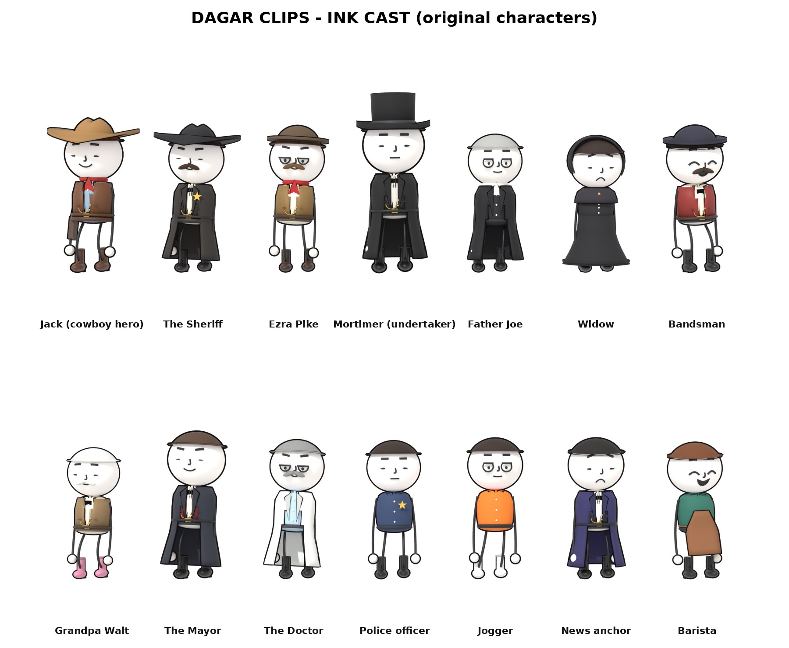

# DAGAR CLIPS ink cast: exact presets

Every character below is an ORIGINAL design made for DAGAR CLIPS. Paste a preset into a story to reuse the same look.



## Western regulars (blender/west/toon.py)
```python
JACK = preset('Jack', '#8fa8bc', '#3c4656', hat='cowboy', hatcol='#a07848', vest='#6a4022', neckerchief='#a82a20', gun=True, haircol='#6a3a1a',
              height=1.04, boots='#5a3420', spurs=True, belt='#4a2c16')
SHERIFF = preset('Sheriff', '#e8e0cf', '#3a342e', hat='cowboy', hatcol='#1e1c20', vest='#2a2426', badge=True, gun=True, stache=True, beardcol='#3a2416',
                 haircol='#3a2416', height=1.0, duster='#2c2824', bolo=True, boots='#1a1614', spurs=True, belt='#1e1612')

```
## The Undertaker cast (blender/undertaker/story.py)
```python
EZ = TO.preset('Ezra', '#ece4d4', '#5a4a3a', hat='bowler', hatcol='#5a4632', vest='#8a6a3a', neckerchief='#b02020', stache=True, beardcol='#6a4a2a',
               haircol='#6a4a2a', height=1.0, boots='#3a2418', belt='#3a2418')
MORT = TO.preset('Mortimer', '#d8d4cc', '#18181c', hat='tophat', hatcol='#121214', vest='#1e1e24', duster='#111114', bolo=True, height=1.12,
                 boots='#0c0c0e', haircol='#2a2a2a', belt='#111111')
JOE = TO.preset('FatherJoe', '#1a1a1e', '#1a1a1e', hat=None, duster='#141418', neckerchief='#f4f0e8', haircol='#a8a8a4', height=.98, boots='#141414')
def widow(i): return TO.preset(f'Widow{i}', '#2a2830', '#1a1a1e', hat='bonnet', hatcol='#1c1a1e', dress=True, dresscol=['#1c1a1e', '#26222a', '#1e1c22'][i % 3],
                               shawl='#2e2a32', haircol=['#2a1a10', '#6a3a1a', '#8a8a88'][i % 3], height=.95, bun=True, collar=False, boots='#111111')
def bandsman(i): return TO.preset(f'Band{i}', '#ece4d4', '#2a2a3a', hat='bowler', hatcol='#2a2a3a', vest='#8a2a24', stache=i % 2 == 0, beardcol='#3a2a1a',
                                  haircol='#3a2a1a', height=1.0 + .04 * (i % 2), boots='#1a1a1a')

```
## City cast (blender/zombie/story.py)
```python
P = TO.preset
WALT = P('Walt', '#e4dccc', '#6a5a48', hat=None, vest='#8a6e4a', haircol='#e0e0dc', stache=True, beardcol='#e0e0dc', height=.93, boots='#d88aa8', belt='#3a2a1a', buttons=True)
MAYOR = P('Mayor', '#f2eee6', '#262a36', hat=None, vest='#6a1e24', duster='#262a36', bolo=True, haircol='#4a3424', height=1.05, boots='#101012', belt='#101010')
DOC = P('Doctor', '#b8d4e8', '#3a3a42', hat=None, duster='#f6f6f2', haircol='#8a8a88', stache=True, beardcol='#8a8a88', height=.99, boots='#1a1a1a', belt='#1a1a1a')
JOG = P('Jogger', '#f07a20', '#1a1a20', hat='cap', hatcol='#1e4a8a', haircol='#2a1a10', boots='#f2f2f2', height=1.0, belt='#1a1a20')
ANCHOR = P('Anchor', '#f2eee6', '#24242c', hat=None, vest='#2a2a3a', duster='#2e2a5a', bolo=True, haircol='#14100c', height=1.0, boots='#101010', belt='#101010')
BARISTA = P('Barista', '#2a6a5a', '#2a2a2e', hat='cap', hatcol='#2a6a5a', apron='#8a5a3a', haircol='#6a3a1a', height=.97, boots='#1a1a1a')
def COP(i): return P(f'Cop{i}', '#2c3e60', '#1a2232', hat='police', hatcol='#1a2232', badge=True, belt='#101010', boots='#0e0e10', haircol=['#2a1a10', '#5a3a1a', '#1a1410'][i % 3],
                     stache=i % 3 == 1, beardcol='#2a1a10', height=.98 + .04 * (i % 3))
def CIV(i):
    r = random.Random(900 + i * 13); hair = r.choice(['#2a1a10', '#1a1410', '#6a3a1a', '#b08040', '#8a8a88', '#4a2a1a'])
    if r.random() < .4:
        return P(f'Civ{i}', '#ece6da', '#2a2a2e', dress=True, dresscol=r.choice(['#c84a4a', '#3a6ab0', '#e0b030', '#4a9a6a', '#8a4aa0', '#e07a40', '#2a2a30']),
                 hat=None, haircol=hair, bun=r.random() < .5, collar=False, height=r.uniform(.92, 1.0), boots=r.choice(['#1a1410', '#c8302a', '#f0f0f0']))
    return P(f'Civ{i}', r.choice(['#e84a3a', '#3a7ad0', '#f0c030', '#4ab07a', '#f0f0ec', '#9a5ad0', '#2a2a30', '#f08aa0', '#40b0c0']),
             r.choice(['#2e4466', '#3a3a40', '#c8b48a', '#1a1a1e', '#5a6a4a']), hat=r.choice([None, None, 'cap']), hatcol=r.choice(['#c8302a', '#1a1a1e', '#2a6aa0']),
             vest=r.choice([None, None, '#3a3a42']), haircol=hair, stache=r.random() < .25, beard=r.random() < .15, beardcol=hair, height=r.uniform(.95, 1.06),
             boots=r.choice(['#f0f0f0', '#1a1410', '#3a2a1a', '#c8302a']))

ZSKIN = (.42, .55, .36)
```
## Crowd generator
Western townsfolk: `TO.crowd_preset(i)` (blender/west/toon.py) - deterministic for each i. Modern city folk: `CIV(i)` (blender/zombie/story.py).

## Expressions
Face names usable in `face=[(t, name)]`:

angry, bored, chat, confused, deadpan, determined, fear, furious, grin, grin2, grin_teeth, grit, happy, idle, laugh, nervous, neutral, ohno, rage, relief, sad, scream, shock, shout, smile, smirk, smug, strain, surprise, suspicious, terror, watch, worry, wow

## Mocap clips (CMU, fetched on CI from blender/west/clips.txt)

Stand/idle 77_02, 77_05, 40_10, 80_48, 80_44; laugh 79_70; react 79_73, 79_74; walk 82_08, 82_09, 82_11, 91_18; run 09_01, 35_17; turn 69_18, 69_19.
