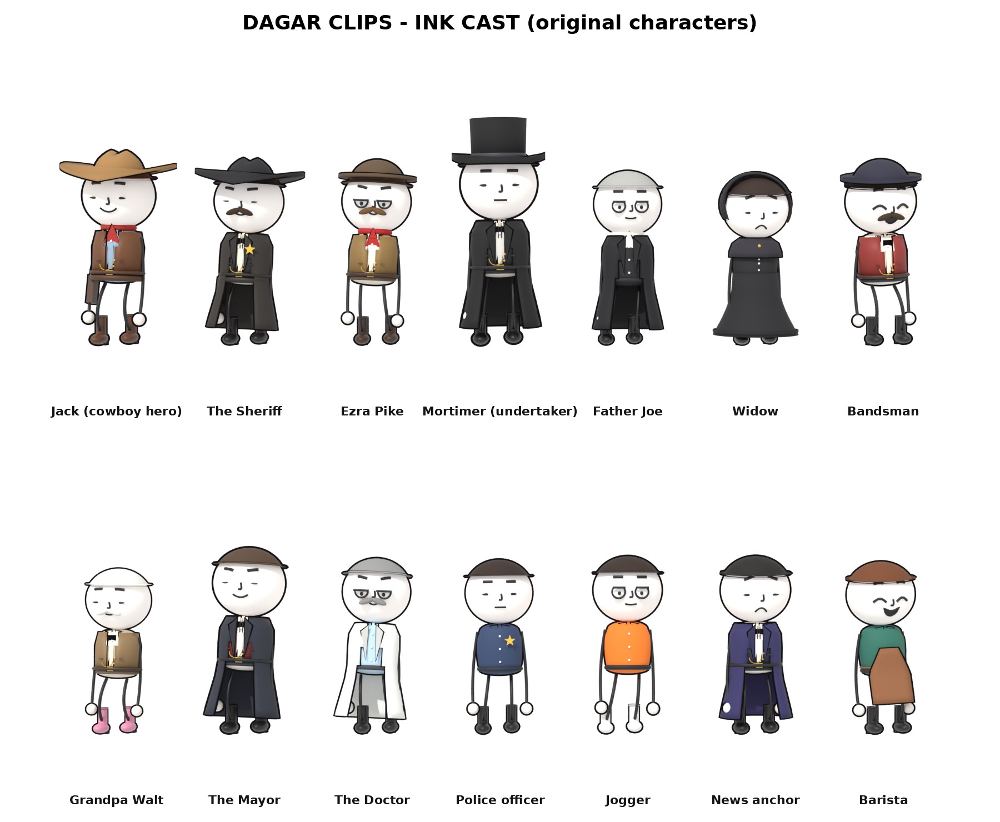

# DAGAR CLIPS — Ink-style video kit

This is everything that makes the DAGAR CLIPS "ink" videos, as used in the cowboy video, *The Undertaker's Best Customer* and the zombie city short:

- ink-outline round-head toon characters with mocap acting
- real 3D worlds (a Wild West town, Boot Hill, a modern city)
- rendering for free on GitHub Actions
- synthesized music and SFX mixed under a free TTS voiceover

Everything in here was made for this channel. The characters are original designs. See `LICENSES.md` for what you own and the credits for the free assets.

## Using it in a new chat or another account

1. Upload `dagar-ink-kit.zip` to the new chat, or put the `code/` folder into any GitHub repo you own.
2. Tell Claude: *"Use the DAGAR ink kit (README + SKILL.md inside) to make a new ink-style video about …"*.
3. Claude reads `SKILL.md` and `CHARACTERS.md`, writes a new `blender/<project>/story.py` (plus `sets.py` or `city.py` if it needs a new place), voices the script with `scripts/tts.py`, and renders on GitHub.

## Layout (`code/`)

| Path | What it is |
|---|---|
| `blender/pirate/inkchar.py`, `human.py` | the round-head ink character (head, eyes, ink outline, expressions) |
| `blender/west/toon.py` | the toon costume system (hats, vests, dusters, dresses, badges…) plus `preset()` and the crowd generator, and the mocap-driven `ToonActor` |
| `blender/west/film.py` | shot engine: `Shot`, cameras, `framed()` / `cu()` close-ups, extras, render loop (`still` / `frames`) |
| `blender/west/town.py`, `dress.py`, `props.py` | Dry Gulch, the western town (street, buildings, signs, horses, props) |
| `blender/undertaker/` | example project with its own sets (Boot Hill, coffins, shop): `story.py`, `sets.py`, `shots.json`, `compose.py` |
| `blender/zombie/` | example project in a brand-new modern city (`city.py`) with a modern cast |
| `blender/real/mocap.py` | the CMU BVH loader and retargeting |
| `blender/lib.py`, `dagar/common.py` | Poly Haven (CC0) texture and HDRI loader, materials, primitives |
| `.github/workflows/*.yml`, `.github/actions/west-setup` | GitHub Actions: stills check, chunked video render, final compose |
| `scripts/tts.py`, `.github/workflows/tts.yml` | free offline TTS (Kokoro-82M + Piper); `asr_check.py` checks that the speech is understandable |

## How a video is made

1. **Script:** split the voiceover into paragraphs. TTS: write `audio/voiceover/
/lines.json`, then run the `TTS voices` workflow with `lines=<that file>`. The narrator is `kokoro:am_michael`.
2. **Timing:** detect the pauses with `ffmpeg silencedetect`, then write `blender/
/shots.json` (`fps 24`, `voice`, `total`, `shots[{id,t0,dur}]`, `trans{id: ['dissolve', s]}`, `subs[]`).
3. **Shots:** in `story.py`, write one `s_<id>(sh)` function per shot. Each one builds the stage, casts toons from presets, gives them acts (mocap clip, place, yaw), expressions, props and a camera. Then call `F.main(SHOTS)`.
4. **Stills check:** set `job.json` to `{"mode":"stills","w":540,"h":960,"samples":24,"at":[0.55]}` and push. Each shot's still lands in `previews/
/`. Have a reviewer agent check the contact sheet and fix the problems until it says APPROVED.
5. **Final render:** set `job.json` to `{"mode":"video","w":1080,"h":1920,"samples":12,"veg":0.7,"chunk":10,"handle":0.25,"env":{"FAST":"1","ADAPT":".04","NOSUBS":"1","NOLOGO":"1"}}`. About 20 jobs run in parallel. The join job runs `compose.py` and writes `previews/
/final_share.mp4`.
6. **Sound:** `compose.py` synthesizes the score and SFX. Keep the background at **20–30 % of the voice** (`music *= .25 * vr / grms(music)`). The `BED=.5` env var halves the whole background bed.

Local quick test (needs `pip install bpy==5.2.3`): `python3 story.py -- still <shot> out.png`

## Gotchas learned the hard way

- `yaw 0` faces −Y and `yaw 180` faces +Y.
- Props held with pose key `handR` must follow `ch.hands['R']`.
- Never trust an object's `matrix_world` right after creating it. Compute from location and rotation, or call `view_layer.update()` first.
- Protect the story cast from `clear_camera()` with `sh.protect` (it hides anything near the lens).
- Flat text planes face −Y. Rotating them by 90° about X lays them flat.
- 9:16 frames are narrow. At lens 26 the half-width is about 0.39 × distance, so stage people in depth.
